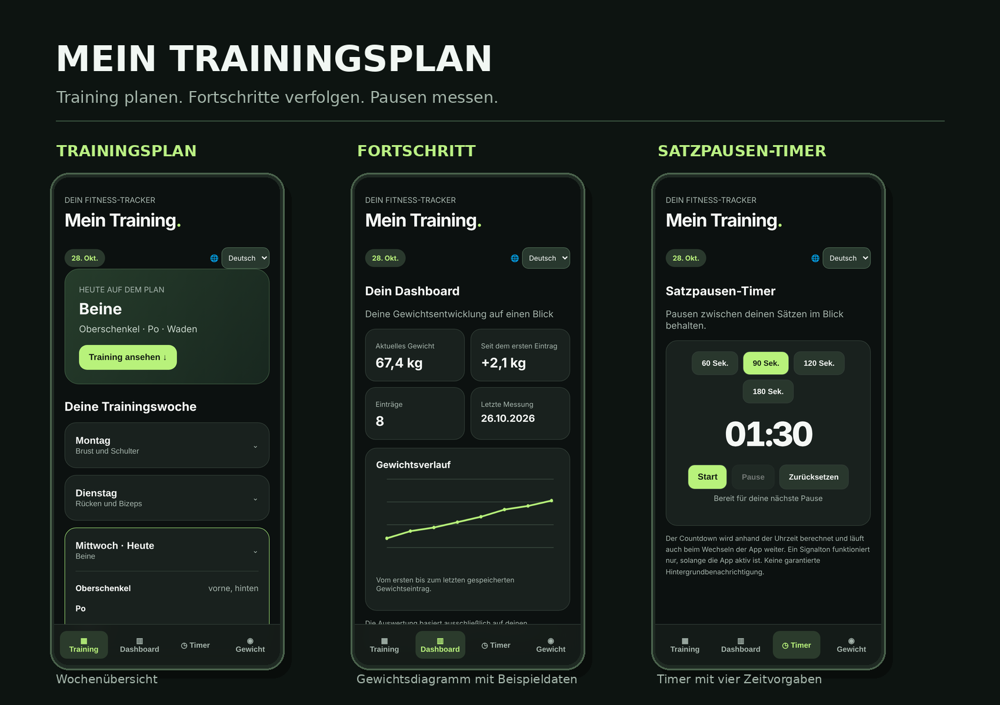

# Mein Trainingsplan

[](LICENSE)


**Eine moderne, mobiloptimierte Fitness-App für Trainingsplanung und Fortschrittskontrolle.**

Direkt im Browser nutzbar oder als Web-App auf dem Smartphone installierbar – ohne Registrierung und ohne zusätzlichen App-Store.

[**App öffnen**](https://alubis45123.github.io/Mein-Trainingsplan/) · [**Quellcode ansehen**](https://github.com/Alubis45123/Mein-Trainingsplan)

Mein Trainingsplan ist eine schlanke Fitness-Web-App, mit der ich meinen Trainingsalltag übersichtlich organisieren und meine körperliche Entwicklung verfolgen kann. Das Projekt ist für den Eigengebrauch entstanden, steht aber allen Interessierten kostenlos zur Verfügung – ohne Registrierung oder Abonnement.

## App-Vorschau



*Die Fortschrittsansicht zeigt ausschließlich Beispieldaten.*

## Funktionen

- **Wöchentlicher Trainingsplan:** Übersicht über sieben Tage mit Muskelgruppen, Trainingsschwerpunkten und Regenerationstagen.
- **Fortschritts-Dashboard:** Aktuelles Körpergewicht, Veränderungen und grafischer Gewichtsverlauf auf einen Blick.
- **Gewichtserfassung:** Messwerte eintragen, Verlauf ansehen und Einträge bei Bedarf löschen.
- **Satzpausen-Timer:** Voreinstellungen mit 60, 90, 120 oder 180 Sekunden sowie Start-, Pause-, Fortsetzen- und Zurücksetzen-Funktion.
- **Sprachauswahl:** Jederzeit zwischen Deutsch (Standardsprache) und Englisch wechseln. Die Auswahl wird auf dem Gerät gespeichert.
- **Ernährungsrichtwerte:** Allgemeine Orientierungswerte für Protein und Kreatin auf Grundlage des zuletzt eingetragenen Gewichts.
- **Installierbare Web-App (PWA):** Zum Startbildschirm hinzufügen und zwischengespeicherte Inhalte offline verwenden.
- **Datenschutzfreundlich:** Gewichtsdaten und Einstellungen bleiben lokal im Browser; ein Benutzerkonto ist nicht nötig.

## Live-Demo

**[Mein Trainingsplan ausprobieren](https://alubis45123.github.io/Mein-Trainingsplan/)**

Die Oberfläche ist für Smartphones optimiert und lässt sich auch auf dem Desktop verwenden.

## Verwendete Technologien

- **HTML5** – Aufbau der Benutzeroberfläche
- **CSS3** – Responsives Design und Gestaltung
- **JavaScript (Vanilla JS)** – Interaktionen und App-Funktionen ohne Framework
- **Web Storage (`localStorage`)** – Lokale Speicherung von Gewichtsdaten und Einstellungen
- **Canvas API** – Darstellung der Fortschrittsdiagramme
- **Service Worker und Web-App-Manifest** – PWA-Funktionalität und Offline-Cache
- **GitHub Pages** – Veröffentlichung der Web-App

Das Projekt benötigt weder ein Frontend-Framework noch ein Backend oder eine externe Datenbank.

## Lokal starten

1. Repository herunterladen oder klonen:

   ```bash
   git clone https://github.com/Alubis45123/Mein-Trainingsplan.git
   ```

2. Projektordner öffnen und einen lokalen Webserver starten (für PWA-Tests empfohlen):

   ```bash
   python -m http.server 8000
   ```

3. Im Browser `http://localhost:8000` öffnen.

Die Benutzeroberfläche lässt sich auch direkt über `index.html` anzeigen. Für Service Worker wird jedoch eine unterstützte sichere Umgebung wie `localhost` oder HTTPS benötigt.

## Datenschutz und Datenspeicherung

Gewichtseinträge, Timer-Zustand und Sprachauswahl werden lokal im Browser gespeichert. Die App benötigt keine Anmeldung und sendet diese Daten nicht an einen Server. Beim Löschen der Website-Daten oder beim Wechsel des Browsers beziehungsweise Geräts kann der gespeicherte Verlauf verloren gehen oder nicht mehr verfügbar sein.

## Entwicklung des Projekts

Ich habe die App entwickelt, um meinen persönlichen Trainingsalltag übersichtlich an einem Ort zu organisieren. Daraus ist ein öffentliches Portfolio-Projekt entstanden, das ich schrittweise erweitere.

Bei der Umsetzung waren mir drei Dinge wichtig:

- **Einfacher Einstieg:** Die App soll ohne Konto oder komplizierte Einrichtung direkt funktionieren.
- **Technische Grundlagen verstehen:** Die Benutzeroberfläche und Funktionen sind mit HTML, CSS und reinem JavaScript umgesetzt – bewusst ohne zusätzliches Frontend-Framework.
- **Datenschutz und Offline-Nutzung:** Trainingsbezogene Eingaben bleiben auf dem Gerät; ein Service Worker ermöglicht die Nutzung zwischengespeicherter App-Dateien auch ohne Netzwerkverbindung.

Der aktuelle Fokus liegt auf einer stabilen, verständlichen Anwendung. Zusätzliche Funktionen werden erst ergänzt, wenn sie im Trainingsalltag wirklich sinnvoll sind.

## Roadmap

**Bereits umgesetzt**

- [x] Mobiloptimierter Wochen-Trainingsplan
- [x] Gewichtserfassung mit Verlauf und Fortschrittsdiagramm
- [x] Satzpausen-Timer mit vier Zeitvorgaben
- [x] Sprachumschaltung Deutsch / Englisch
- [x] Installierbare PWA mit Offline-Cache

**Geplant / mögliche Erweiterungen**

- [ ] Trainingsplan und Übungen individuell bearbeiten
- [ ] Sätze, Wiederholungen und Trainingsgewichte protokollieren
- [ ] Trainingsfortschritt über längere Zeiträume auswerten
- [ ] Daten lokal exportieren und wieder importieren
- [ ] Bedienbarkeit und Barrierefreiheit weiter verbessern

Die Roadmap zeigt Ideen für die Weiterentwicklung, keine festen Veröffentlichungstermine.

## Projektstatus

Aktives, persönliches Entwicklerportfolio-Projekt. Erweiterte Trainingsanalysen oder eine geräteübergreifende Synchronisierung sind derzeit noch nicht implementiert.

## Hinweis

Angaben zu Protein und Kreatin dienen ausschließlich der allgemeinen Orientierung und stellen keine individuelle medizinische oder ernährungswissenschaftliche Beratung dar.

## Lizenz

Dieses Projekt ist unter der MIT-Lizenz veröffentlicht. Weitere Informationen findest du in der Datei [LICENSE](LICENSE).
